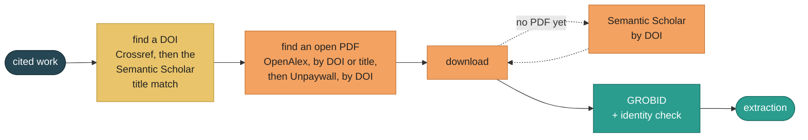
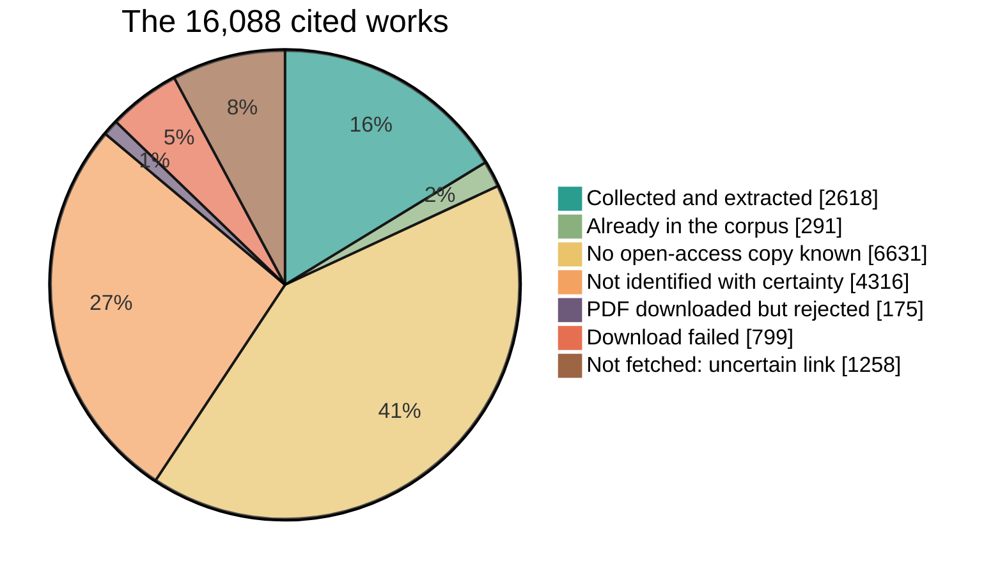

# Appendix

What the paper's appendix leaves out for lack of space. Every number here is read from the repository's outputs, and next to each table is the command or file that gives it again.

## 🗺️ Where the paper's appendix lives in the repository

| Paper appendix | In the repository |
|---|---|
| The Scopus search query of the literature search | [docs/step-1-2-papers/seeds.md](docs/step-1-2-papers/seeds.md#the-search-query), word for word |
| Relevance classification of the scientific papers | [docs/step-1-2-papers/relevance.md](docs/step-1-2-papers/relevance.md#the-prompts) |
| Information extraction: MBDef-Gold's agreement, the DefScore metric | [docs/step-3-extraction/evaluate.md](docs/step-3-extraction/evaluate.md) |
| Information extraction: the choice of the extractor | [docs/step-3-extraction/selection.md](docs/step-3-extraction/selection.md) |
| Post-processing | [docs/step-5-post-processing/postprocess.md](docs/step-5-post-processing/postprocess.md) |
| Pair scorers on DefSim, the comparison with Claude Opus, the corpus closure | below |

## 📏 Pair scorers against DefSim's human ratings

> [!TIP]
> Calibration cuts the error against the ratings to a third (MAE 0.165 → 0.052); the three calibrated combinations are within 0.007 of each other on every measure, and DefScore needs no BGE-large.

The 60 definition pairs of DefSim, rated 1 to 5 by people (mapped to 0–1). The full version of the paper's metric table:

| Pair scorer | Calibrated | Pearson | Spearman | MAE |
|---|:-:|--:|--:|--:|
| Entailment alone (SciDef's NLI score, the baseline) | – | 0.937 | 0.871 | 0.100 |
| Mean of word overlap, BGE-base and entailment | – | 0.980 | 0.908 | 0.165 |
| The larger of word overlap and the mean of BGE-large and entailment | – | 0.973 | 0.908 | 0.208 |
| **DefScore**: mean of word overlap, BGE-base and entailment | ✓ | **0.985** | 0.914 | 0.052 |
| The larger of word overlap and the mean of BGE-large and entailment | ✓ | 0.978 | **0.917** | 0.052 |
| The larger of word overlap and the mean of BGE-base and entailment | ✓ | 0.982 | 0.913 | **0.049** |

*Word overlap* is the F1 of the lowercased words; *BGE-base* and *BGE-large* are the cosine similarities of `BAAI/bge-base-en-v1.5` and `bge-large-en-v1.5` embeddings; *entailment* is `tasksource/ModernBERT-large-nli`, averaged over both directions. *Calibrated* means a straight line fitted to the ratings on four of five paper-disjoint folds and scored on the fifth, so no pair is scored by a line fitted on it.

**Source:** `results` in [`data/frozen/artifacts/defsim_benchmark.json`](data/frozen/artifacts/defsim_benchmark.json), gate `none`: the rows `SciDef_NLI`, `bge_base_raw_mean_lex_bge_nli` and `bge_large_raw_max_lex_mean_bge_nli` of `no_defsim_label_fit`, and in `defsim_calibrated_oof` the same two combinations and `bge_base_raw_max_lex_mean_bge_nli`, each with `_OOF_affine_final` appended. The record keeps the scores but not the 60 pairs' similarities, so it is read, not recomputed; [docs/step-3-extraction/evaluate.md](docs/step-3-extraction/evaluate.md#the-pinned-settings) says where DefScore's two constants come from.

## 🤖 Our extractor against Claude Opus

> [!TIP]
> On the 50 papers of DEV and TEST the two cannot be told apart: every 95% interval of the difference includes 0. Ours has no API bill.

**Opus:** Claude Opus 5 through OpenRouter, high reasoning, 8,000-character windows, its own prompt trained with DSPy's Bootstrap, then the same Qwen verifier as ours. **Ours:** the P≥28 extractor, Gemma 4 12B on windows of 8,000, 16,000 and 32,000 characters, then the Qwen verifier and the relevance filter.

| System | TEST (29 papers, 365 definitions) found / predicted | P / R (%) | DEV (21 papers, 115 definitions) found / predicted | P / R (%) |
|---|--:|--:|--:|--:|
| **Ours**: Gemma 4 12B + Qwen verifier + filter | **294** / 961 | **30.6** / **80.5** | 95 / 436 | **21.8** / 82.6 |
| Claude Opus 5 + the same verifier | 290 / 1,002 | 28.9 / 79.5 | **100** / 521 | 19.2 / **87.0** |

```mermaid
---
config:
  xyChart:
    width: 760
    height: 400
    yAxis:
      showLabel: false
      showTick: false
  themeVariables:
    xyChart:
      plotColorPalette: "#2a9d8f, #e76f51"
---
xychart-beta horizontal
    title "Ours (green) and Claude Opus (orange), in %"
    x-axis ["TEST recall, ours: 80.5", "TEST recall, Opus: 79.5", "TEST precision, ours: 30.6", "TEST precision, Opus: 28.9", "DEV recall, ours: 82.6", "DEV recall, Opus: 87.0", "DEV precision, ours: 21.8", "DEV precision, Opus: 19.2"]
    y-axis 0 --> 100
    bar [80.5, 0, 30.6, 0, 82.6, 0, 21.8, 0]
    bar [0, 79.5, 0, 28.9, 0, 87.0, 0, 19.2]
```



Ours minus Opus, from a paired bootstrap over papers (both systems resampled together, 20,000 times):

| Split | Recall difference, points [95% CI] | Precision difference, points [95% CI] | Papers where ours finds more / fewer / the same |
|---|--:|--:|--:|
| DEV (21 papers) | −4.3 [−14.1, +3.4] | +2.6 [−2.6, +6.8] | 2 / 7 / 12 |
| TEST (29 papers) | +1.1 [−7.9, +9.3] | +1.7 [−3.2, +5.8] | 13 / 7 / 9 |

**Reproduce both tables:** `uv run mbdef evaluate paired --out /tmp/paired` (about 1 s, no GPU; [docs/step-3-extraction/evaluate.md](docs/step-3-extraction/evaluate.md#our-extractor-against-opus-paper-by-paper)).

> [!NOTE]
> Each system looks best on the split it was chosen on: our extractor was selected on TEST, Opus's setup on DEV. So Opus leads on DEV by 5 definitions (100 against 95 of 115) and ours on TEST by 4 (294 against 290 of 365).

**Cost and calls.**

| | Ours | Claude Opus 5 |
|---|--:|--:|
| API bill, TEST (29 papers) | none: self-hosted | **$41.28**, about $1.42 per paper |
| Model calls, DEV (21 papers) | 606 | 270 |
| Model calls, TEST (29 papers) | 1,087 | 494 |

Ours makes more calls because it reads every paper at three window sizes; Opus reads it once, in 8,000-character windows. At Opus's TEST rate, one extraction of all 6,479 papers would cost about **$9,200** (an extrapolation, not a bill). For the 3,869 seed papers our extractor made 52,260 Gemma calls (357M input and 208M output tokens, 179M of them reasoning) and 34,468 Qwen verifier calls (134M input tokens), on our own GPUs: one A100 per Gemma copy, two GPUs per Qwen copy. GPU-hours were not measured.

**Sources:** the bill is `cost_usd` in the Opus row's `status.json` of the held-out TEST evaluation; the calls are `model_calls` and `opus_reference` in the selection's `results.json` (both files: [docs/step-3-extraction/evaluate.md](docs/step-3-extraction/evaluate.md#our-extractor-against-opus-paper-by-paper)); the seed run's calls and tokens are in the `status.json` and usage logs of its part archives, which hold paper text and are not public ([docs/step-3-extraction/extract.md](docs/step-3-extraction/extract.md#the-seed-runs-variants-extract-derive)).

## 🔗 The corpus closure

> [!TIP]
> One level of citations adds 2,610 papers to the 3,869 seed papers: 6,479 papers with 110,639 definitions. Most cited works are out of reach because no open-access copy is known (41%) or they cannot be identified with certainty (27%).

These are the numbers of the **P≥28 view**: the citations of the seed papers' P≥28 items and the papers they lead to, which MBDef uses. The released closure follows the citations of all four variants (25,316 works, 4,556 papers; [docs/step-4-closure/closure.md](docs/step-4-closure/closure.md#what-the-step-does)).

**Markers.** For each item extracted from a seed paper that carries a citation marker (`[12]`, `(Entman, 1993)`), `closure run` looks for the marker's entry in the paper's reference list:

| Citation markers of the P≥28 items | Markers |
|---|--:|
| **found their entry** | **37,724 (81.4%)** |
| a number with no matching entry | 3,191 |
| an entry that exists only as unparsed text | 1,711 |
| an author and year missing from the reference list | 1,711 |
| a bare year that fits several entries | 901 |
| other: no matching year or surname (596), a page number alone (343), no reference list in the TEI (159), a note number (7) | 1,105 |
| all | 46,343 |

The matched markers name **16,088** distinct cited works.
*Reproduce:* `closure run` ([docs/step-4-closure/closure.md](docs/step-4-closure/closure.md#run-it)) on the union of the four seed variants that the release resolved (its `seeds/derived/union/predictions.json`) resolves 91,484 markers; 46,343 belong to P≥28 items, by the key that fills the `in_P28` column of `links/definition-links.csv` (paper, term, field, item text, citation).

Each cited work is looked up in this order, and only works whose citation is linked with certainty and which are not yet in the corpus are fetched ([docs/step-1-2-papers/collect.md](docs/step-1-2-papers/collect.md#what-the-step-does)):



The identity check compares every downloaded PDF with its citation, because a title search can return the wrong work ([docs/step-4-closure/closure.md](docs/step-4-closure/closure.md#the-pdf-identity-check)). What became of the 16,088 cited works:



| Outcome | Works | Share | What happened |
|---|--:|--:|---|
| **Collected and extracted** | **2,618** | 16% | an open PDF was found, downloaded, confirmed to be the cited work and extracted |
| Already in the corpus | 291 | 2% | a seed paper already |
| No open-access copy known | 6,631 | 41% | identified, but no source knew an open PDF |
| Not identified with certainty | 4,316 | 27% | no source knew it (4,068: books, reports, garbled references), or two works fit equally well (248) |
| PDF downloaded but rejected | 175 | 1% | not shown to be the cited work (131), another work's PDF (33), or no usable text (11) |
| Download failed | 799 | 5% | an open-access link was known, but the download failed (mostly publishers' bot protection) |
| Not fetched: uncertain link | 1,258 | 8% | the citation matched its entry only weakly (low confidence, several equally good entries, or a year that disagrees), or the corpus check could not tell whether the work is already in the corpus. The collect step fetches only works marked `missing`; these were marked `review`, and no manual decision was made on them |

*Reproduce:* the `work_status` of the works that a P≥28 item cites, in the closure release's `links/cited-works.csv` (`closure bundle` rebuilds it byte for byte, [docs/step-4-closure/closure.md](docs/step-4-closure/closure.md#how-it-was-checked)):

```bash
python3 - "$DATA_ROOT/frozen/closure/definition-corpus-v1.1/links/cited-works.csv" <<'PY'
import collections, csv, sys
csv.field_size_limit(1 << 30)
works = [w for w in csv.DictReader(open(sys.argv[1])) if "P28" in w["outputs_citing"].split("; ")]
print(len(works), collections.Counter(w["work_status"] for w in works).most_common())
PY
```

The 2,618 collected works are **2,610 papers**: 8 works that the grouping kept apart are the same PDF. 2,084 of the papers (80%) are cited in a sentence that is itself a definition; 526 only in other fields (descriptions, examples, related terms and so on).

**What the extractor found.**

| | Papers | Records | Definitions |
|---|--:|--:|--:|
| Seed papers | 3,869 | 38,659 | 62,433 |
| Closure papers (P≥28 view) | 2,610 | 29,292 | 48,206 |
| **Together** | **6,479** | 67,951 | **110,639** |

A seed paper has a median of 12 definitions (90th percentile 33); 110 seed papers gave none. 41.3% of the seed definitions carry at least one citation marker.
*Reproduce:* `extract derive` prints the seed counts ([docs/step-3-extraction/extract.md](docs/step-3-extraction/extract.md#the-seed-runs-variants-extract-derive)); the closure row counts the release's `closure/derived/P28/predictions.json` for the papers that a link row with `in_P28` = 1 names, as Step 5 reads the view ([docs/step-5-post-processing/postprocess.md](docs/step-5-post-processing/postprocess.md#the-corpus-store)).

**The other variants** of the same run trade precision for recall. P≥28 balances drowning in extractions against missing definitions, with at least 80% TEST recall:

| Variant | TEST recall | TEST precision | Seed definitions |
|---|--:|--:|--:|
| P≥20, the most complete | **86.8%** | 20.5% | 106,339 |
| P≥24 | 84.9% | 25.8% | 77,560 |
| **P≥28**, used here | 80.5% | **30.6%** | 62,433 |
| P≥28, Gemma only (no Qwen verifier) | 80.5% | 28.4% | 69,795 |

*Reproduce:* `evaluate select` prints the recall and precision ([docs/step-3-extraction/selection.md](docs/step-3-extraction/selection.md#run-it)), `extract derive` the definitions ([docs/step-3-extraction/extract.md](docs/step-3-extraction/extract.md#the-seed-runs-variants-extract-derive)).
